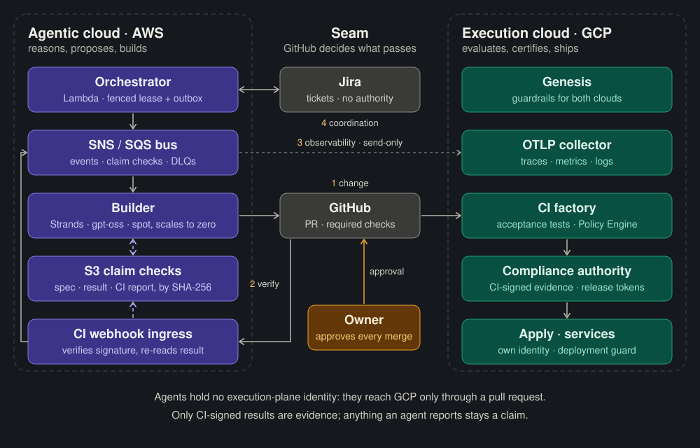
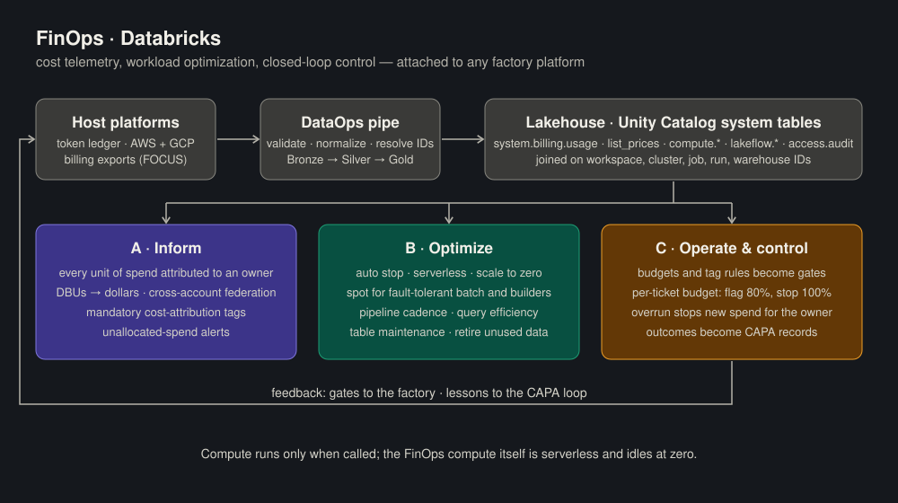
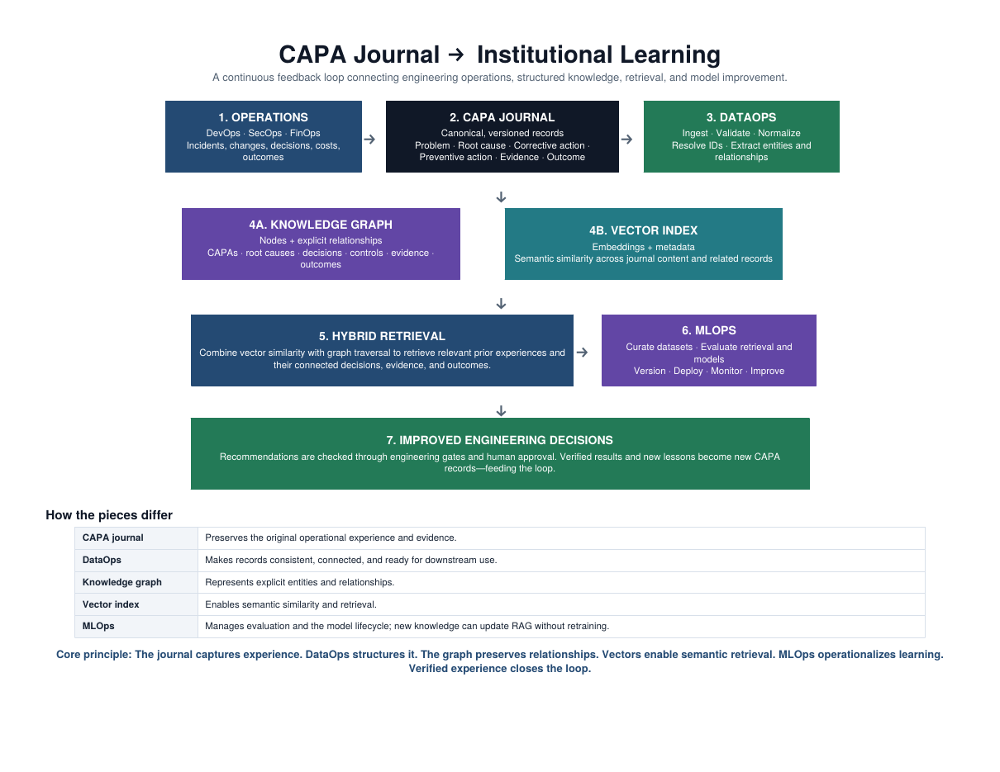
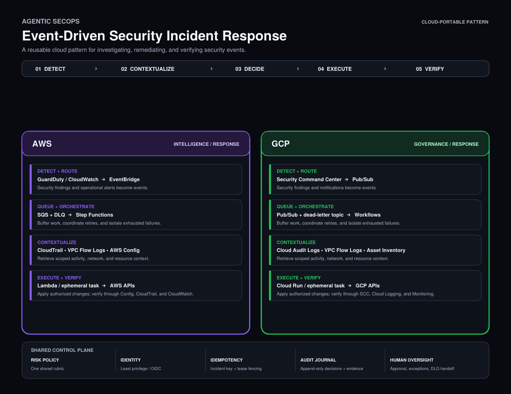

# 🚀 Andres Arias

**Senior Cloud Engineer & Node.js Developer | AWS Solutions Architect | Distributed Systems | Infrastructure Automation**

I'm building a software factory: AI agents that turn an approved requirement into a released change, under the same standards, gates, and human-approved merges as any engineer. The standard it is held to is public, in the [Engineering Excellence Playbook](https://github.com/Drecoder/Engineering_Excellence_Playbook).

The rule I hold myself to: a standard counts only when it is enforced and running, not when it is written down.

📓 **[Proof journal](https://github.com/Drecoder/Engineering_Excellence_Playbook/blob/main/docs/POC_JOURNAL.md):** what applying the playbook actually found while building the factory, each finding written up as a CAPA post-mortem (problem, root cause, correction, preventive action, verification), including the ones still open. CI enforces append-only on every pull request, on `main`, and daily. Since Nov 16, every finding starts as a tracked issue whose number is its ID, and the journal and register are projected from those issues (by hand until the projector, now in review, lands). A CAPA register ranks every finding by severity with a mandatory deadline (critical 7 days, high 30, medium 90, low 180), measures how many controls are proven to fail on their defect, and keeps production readiness false while any critical or high security or governance finding is open.

🧰 **[agent-ddi-harness](https://github.com/Drecoder/agent-ddi-harness)** (open source, MIT): a local-first DDI/EEP pre-push harness for agents and CLI workflows. One loop runs on every `git push`: it scopes the change, ranks the playbook-style rules that apply, enforces the machine-checkable ones, runs CRAP, then mutation, then the TDD pyramid on the exact pushed commit, and turns every failure into a structured CAPA or merge-conflict draft. Everything it writes stays an unverified claim until CI signs the result. Python and git only, no cloud and no keys; it gates its own pushes. A reference implementation of Domain-Driven Intelligence (DDI): DDD, TDD, and event-, error- and evidence-driven development governing how agents work.

## 🏛️ The Architecture



The factory separates the ability to reason about, propose, and build a change from the authority to evaluate, approve, and execute it.

- **Agentic plane (AWS):** the orchestrator, the Builder and its models, retrieval, and the event bus. It proposes and builds.
- **Execution plane (GCP):** central CI, the Policy Engine, the compliance authority, infrastructure apply, and the services. It evaluates, certifies, and ships.
- **GitHub is the seam.** Agents hold no identity in the execution plane; they reach it only by opening a pull request. Required checks, CODEOWNERS, and protected branches decide what gets through, and I approve every merge.
- **Agents produce claims, never evidence.** Only results signed by CI's identity count as evidence. Anything an agent reports about its own work stays a claim.

## 🧪 A Software Factory That Operates as an AI Lab

At a glance it is a software factory. Underneath, every loop produces measured evidence (CAPA records, mutation scores, autonomy events, cost per ticket), and the system changes how it behaves only on that evidence. That is what makes it a lab. It becomes one loop at a time, and a loop counts only once it is closed and running:

| Closed loop | Designed | Running today |
| --- | --- | --- |
| Quality: CRAP, then mutation, decided by the Policy Engine | ✅ | ✅ in the central CI; repositories moving onto it |
| A skipped gate is never a pass: the Gates verdict | ✅ | ✅ required by two repositories; the rest follow |
| Build, CI, fix: the Builder's loop | ✅ | ⏳ first dry run next |
| Autonomy by evidence: promote and demote on measurements | ✅ | ⏳ the evidence loop for auto-merged updates is next |
| Cost into budgets as gates (FinOps) | ✅ proposed | Run 1 |
| CAPA intake: a failing control opens its own finding | ✅ | ⏳ findings are tracked issues; the projector is in review, detectors next |
| CAPA records into institutional learning (MLOps) | ✅ proposed | Run 2 |
| Security events into investigated, verified responses (SecOps) | ✅ proposed | Run 3 |

### Patterns that attach to every platform the factory builds

FinOps, MLOps and SecOps are written once and attached to any platform the factory produces, the factory itself first, through one versioned contract each. **DataOps** is the shared pipe beneath them: ingest, validate against versioned contracts (rejected, never repaired), normalize, resolve IDs, and land in Bronze, Silver and Gold. The patterns read Gold only. ([Platform patterns in the playbook](https://github.com/Drecoder/Engineering_Excellence_Playbook/blob/main/07_SoftwareFactory/02_Platform_Patterns.md), proposed.)

**FinOps on Databricks:** every unit of spend attributed to an owner, workloads right-sized, and budgets turned into gates.



**MLOps, CAPA journal to institutional learning:** the journal captures experience, DataOps structures it, a knowledge graph and a vector index make it retrievable, and verified results become new CAPA records. Retrieval comes first; fine-tuning stays closed until it is decided as a protected change.



**Agentic SecOps:** a cloud-portable incident-response pattern (detect, contextualize, decide, execute, verify) on AWS and GCP. Remediation is a protected class: I approve every remediating action, on every platform it attaches to.



### The factory runs

Each pattern is built by the factory itself, as a run at the MVP stage: approved specs, acceptance tests first, the central gates, my approved merges, and a metered budget per ticket. No run starts before the one it depends on reaches its MVP.

| Run | Builds | Depends on |
| --- | --- | --- |
| 0 | The factory's own MVP: one real ticket, gated, approved, merged, within budget | |
| 1 | DataOps pipe, then FinOps, attached to the factory | Run 0 |
| 2 | MLOps: CAPA to institutional learning | Run 1 |
| 3 | Agentic SecOps, attached to the factory | Runs 1 and 2 |
| 4 | The pentest platform, rebuilt through the factory with SecOps attached | Run 3 |

## 🎯 The Goals

Not a bigger factory: a smaller one that is complete and independently verifiable. No new features until the first complete release path is proven.

**Current milestone: MVP.** One real ticket built by the Builder, passing CI including its acceptance tests and the Policy Engine, approved by me and merged, within a $2.00 metered budget. Stages: operational safety, the factory loop, the MVP gate.

**P0: Prove the trust boundaries**

- Rulesets and required checks on every factory repository, with no bypass. Rulesets now protect eight of the factory's repositories, with the required checks bound to GitHub Actions (INC-001 fixed, not yet proven: a refused direct push is still to be shown). A required approving review waits until the agents act under their own GitHub App identities.
- Agents hold no execution-plane identity and cannot change the checks that evaluate them.
- Compliance decisions bound to the exact commit, CI run, image digest, and policy version.
- Tampered, expired, mis-scoped, and replayed release tokens rejected; a token consumed exactly once, even under concurrent requests; deploys fail closed when the verifier is down.
- Deploys refused for any image without trusted attestations.
- **Exit:** negative tests show each unauthorized path is rejected, and the paths not yet tested are listed.

**P0: Complete one release lifecycle**

- One change from approved spec through the Builder, the central gate with its acceptance tests and Policy Engine, a human-approved merge, signed provenance and an SBOM, the compliance decision, and deployment admission.
- The Policy Engine's decision core was built and merged ahead of the loop, so the Builder's first real ticket is another service. The agents then take Genesis, whose gate is red today, to green.
- **Exit:** a reproducible run with a verified artifact, an auditable decision, and a deploy, with no other way to release.

**P1: Demonstrate the economics**

- Factory-assisted delivery against a documented manual baseline, on comparable tasks with the same acceptance criteria: time from requirement to accepted release, human correction time, escaped defects, cost per accepted change, and recovery time.
- Target: idle costs nothing, and every ticket has a metered budget. Compute runs only when called, on spot capacity that scales to zero.
- **Exit:** the measurements published with their method, sample size, and limits.

**P2: Earn broader autonomy**

- Larger work only after repeated evidence of reliable behavior, with escalation paths, recovery procedures, and explicit limits on high-risk operations.
- **Exit:** a defined workload handled with measured reliability, bounded authority, and safe recovery.

Progress is scored from evidence against the playbook. Baseline 61 (Oct 28); the latest formal re-grade, 50 (Nov 6), counts only what is enforced and running on `main`. Next target 70, toward a bar of 90. The MVP score in the roadmap below is a separate measure: progress toward the MVP itself, estimated from merged work.

## 🗺️ Roadmap

🧭 **[Features Map](https://claude.ai/artifact/NpwCvBoUaFQ6KPqoUaPZr5)** (private to me): my to-do list, the MVP phases, the roadmap, every open item across the factory's repositories, and the board, synced daily.

Where the MVP stands (Nov 16), scored from what is merged and running:

```text
MVP
  now         █████████████████████████░░░░░░░░░░░░░░░  ~63
  1st dry run █████████████████████████████░░░░░░░░░░░  ~73
  MVP         ████████████████████████████████████████  100

PHASES
  0 Unblock       █████████████████░░░   8.5/10  rulesets on eight repositories; the agents' own GitHub App left
  1 Orchestrator  █████░░░░░░░░░░░░░░░   8/30    two proven defects fixed, tested and merged
  2 Builder + CI  ████████████░░░░░░░░  15/25    ◂ here: a manifest now merges only with its lockfile; runner image next
  3 Journal loop  ████░░░░░░░░░░░░░░░░   3.5/20  findings start as tracked issues; the projector is in review
  4 Harness       █░░░░░░░░░░░░░░░░░░░   1/15    proposed; its conformance tests are merged
```

The overall roadmap, scored against the whole playbook (a separate measure from the MVP score above):

```text
PLAYBOOK SCORE (0–100)
  baseline Oct 28   ████████████████████████░░░░░░░░░░░░░░░░   61
  formal Nov 6      ████████████████████░░░░░░░░░░░░░░░░░░░░   50  ◂ last re-grade: only what runs on main
  PI-1 PoC          ████████████████████████████░░░░░░░░░░░░   70  notepad, event handoff, consumers repinned, golden tasks, SLOs
  PI-2 Pilot        ██████████████████████████████████░░░░░░   85  branch protection, signed releases, bootstrap apply, live telemetry
  bar               ████████████████████████████████████░░░░   90
  PI-3 Production   ████████████████████████████████████░░░░   91  Genesis green, verified deploys, governance closed
  PI-4 Scale        █████████████████████████████████████░░░  ≥93  autonomy promoted per class on evidence
```

After the MVP come the factory runs in order (FinOps, MLOps, Agentic SecOps, the pentest platform), each one starting only when the run before it reaches its MVP.

Since Nov 11: rulesets protect eight of the factory's repositories, two repositories require only the Gates verdict, Dependabot auto-merge is on, and the orchestrator's two fault-injection defects are fixed and merged. The CRAP gate also blocked a real regression in an agent-written fix before merge, the first time it caught one outside a test fixture.

Since then, the guardrail for the one open critical finding is merged: auto-merge refuses a dependency manifest that arrives without its lockfile. The finding closes once the two affected repositories repin to it, before its Nov 23 deadline.

Three things went the other way. Auto-merge let a dependency bump through without its lockfile; that is the critical finding above. The CI runner pool sat at zero for four days with nothing to tell me, which is why runners that scale from zero on demand, with a queued-job alert, are in review. And the workflow that bakes the runners' image merged without ever running its real path, so it could not succeed; the fix is in review. All three are findings with deadlines.

Also in review since then: one board workflow for all work, development and CAPA alike, so every finding and every change has a ticket before the work starts; and a Features Map per repository, generated from its code, its gates and its findings, with a gate that fails when the map no longer matches the code. One Features Map sheet carries every repository's features, the board, the MVP phases and the roadmap above, synced daily.

Next, in order: close the critical finding; the baked runner image and on-demand runners; the CAPA projector, then its first detector, so a failing control opens its own finding; the agents open pull requests as their own GitHub App, because my review is the loop's bottleneck; then the first dry run of one ticket through the loop.

## 📘 The Playbook

The [Engineering Excellence Playbook](https://github.com/Drecoder/Engineering_Excellence_Playbook) is the factory's rulebook. Its enforceable rules (`AGENTS.md`) are vendored into each service repository at a pinned commit, so engineers, coding assistants, and the factory's own agents read the same contract.

- Standards by zone: universal, frontend, backend, infrastructure, runbooks, agents, and the software factory.
- Contracts as versioned JSON Schemas with test vectors.
- Incident records in post-mortem form for every failure and near miss, each pointing at its evidence.
- Program increments that grade the factory against the playbook from evidence.

## 🏭 The Factory

The Builder writes a change; CI evaluates it; I approve the merge. A failing CI report goes straight back to the Builder, which fixes its own change, up to 3 attempts within the $2.00 budget. Every ticket has acceptance tests written before the build and shown to fail first.

Each repository is a bench with one job. The playbook is public; the benches are private.

| Bench | Plane | Job | Status |
| :--- | :--- | :--- | :--- |
| Central CI | Execution | One reusable gate that every repository calls | Running |
| Policy Engine | Execution | Decides PASS, BLOCK, or QUARANTINE from normalized quality metrics, with no network and no model | Running in the central gate: CRAP from ESLint complexity and coverage, measured on the change and its merge base |
| Orchestrator | Agentic | Leases one approved Jira ticket at a time, hands it to the Builder, and reads the CI result; the only writer to the board | Fenced lease, telemetry, and a deployable image on `main` (built, tested inside its container, and scanned in CI); its two fault-injection defects fixed (re-dispatch is bounded, and a stale attempt can no longer push). Its Jira, DynamoDB, and GitHub adapters and the AWS deploy come next |
| Builder | Agentic | A Strands agent on open-weight gpt-oss-20b, on spot capacity that scales to zero; gpt-oss-120b on Bedrock for harder tickets | Pull-request wrapper built; open-weight Builder designed |
| Event bus | Agentic | SNS and SQS with claim checks, an outbox, and dead-letter queues | Designed; part of the MVP |
| rig | Agentic | Measures: architecture checks, features, the symbol index | Built |
| Notepad | Agentic | Working memory: a sealed, hash-chained record of every task | Library on local backends |
| Compliance authority | Execution | Verifies evidence and issues single-use release tokens | Runs as a CLI; service in progress |
| Genesis | Both | Governance guardrails, every IaC module and IAM role the platform uses, and service vending, per cloud | Proof of concept; MVP scoped: GCP and AWS, the Builder vended first. Its first run on the real gates is open |

The Reviewer agent and the separate fixer agents are retired: deterministic CI and per-ticket acceptance tests evaluate every change, and the Builder fixes its own.

No model provider checks its own output: the model that writes a change and the one that writes its acceptance tests come from different providers. An architect, person or agent drafts each spec, and work starts only when I approve the ticket.

## ✅ Running Today

- One central CI gate, called by commit SHA from every repository: secret scanning, Trivy, Semgrep, and per-stack lint, type checks, tests, coverage floors, and license policy. One severity rule for every scanner: CRITICAL or CISA KEV blocks, and the gate fails closed.
- The gate tests itself. Fixture projects run the real gate on every change to it, and each check is shown to fail on the defect it guards against before it counts.
- A skipped job is not a pass, enforced: one Gates verdict check works out which gates had to run for the repository and fails unless every one succeeded, so each repository requires a single check.
- Code quality in the gate: CRAP scoring first, then mutation testing with Stryker, decided by the Policy Engine. New functions need CRAP ≤ 15 and 80% coverage; nothing may get worse than its baseline.
- Dependabot patch and minor updates merge on their own, only after every required check passes, and never as a manifest without its lockfile; major updates and anything else stay with me.
- Every service ships a container image: the gate builds it, runs its tests inside it unprivileged with no network, and scans it, and fails a repository that neither builds one nor says why it has none. Vulnerabilities are fixed at their source, not excepted.
- Pinned inputs: images by digest, actions by commit SHA, downloaded tools by checksum, dependencies through committed lockfiles.
- The Quality Policy Engine: its standard, contracts, and 54 test vectors in the playbook, and its decision core with 98 tests, 99% coverage, and every hand mutant killed.
- The CAPA register's controls run on every pull request, on `main`, and daily: a row for every journal entry, deadlines within their severity, overdue findings failing the daily run, and production readiness reported.

## 🔜 Now

**Unclog the human in the loop.** I review and approve every merge, so anything that slows my part goes first: the agents open pull requests as their own GitHub App (its key held non-exportable in Cloud KMS), every repository requires the one Gates verdict, and CI runners boot from a baked image and scale from zero only when work is queued.

Then the CAPA journal runs itself: a failed gate, a red check on `main`, a Policy Engine block or a job queued too long opens its own finding, and the journal is projected from the findings in one batched change I approve. The projector is in review; the first detector follows it.

## ⏭️ Next

- **The factory loop on AWS:** the orchestrator, the open-weight Builder, and the event bus, carrying one ticket through CI to my approval.
- **Genesis builds every cloud from one CI:** the central CI holds the logic once; the runner and the cloud identity are injected, so the same plan and apply reach GCP through Workload Identity Federation and AWS through OIDC roles. Genesis vends the Builder first.
- **Continuous delivery:** every merge publishes an image by digest with an SBOM, a keyless signature, and SLSA provenance; promotion through human-approved merges; deploys admitted only through a deployment guard and Binary Authorization.

## 🗓️ Later

- **Autonomy by evidence:** a person leaves a step only when the measurements show the step is stable and better without them.
- **The adaptive harness:** agents that choose their next step from reliability and quality evidence, without ever authorizing themselves. Proposed in the playbook; built in its own project, with the pentest platform.
- **The learning loop:** each agent keeps its own journal and learns only from its own verified mistakes. The journal becomes a graph with risk weights that steer nothing until they are calibrated, and fine-tuning stays closed until it is decided as a protected change. [Proposed in the playbook](https://github.com/Drecoder/Engineering_Excellence_Playbook/blob/main/06_AgentZone/10_CAPA_Graph_and_Risk_Weighted_Learning.md); built as Run 2.
