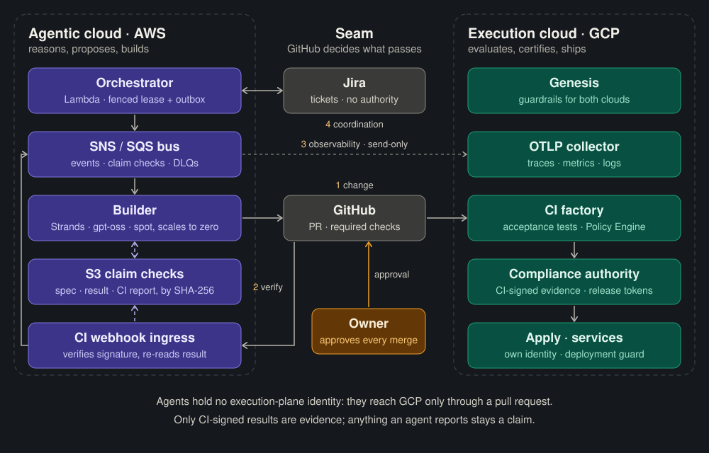

# 🚀 Andres Arias

**Senior Cloud Engineer & Node.js Developer | AWS Solutions Architect | Distributed Systems | Infrastructure Automation**

I'm building a software factory: AI agents that turn an approved requirement into a released change, under the same standards, gates, and human-approved merges as any engineer. The standard it is held to is public, in the [Engineering Excellence Playbook](https://github.com/Drecoder/Engineering_Excellence_Playbook).

The rule I hold myself to: a standard counts only when it is enforced and running, not when it is written down.

📓 **[Proof journal](https://github.com/Drecoder/Engineering_Excellence_Playbook/blob/main/docs/POC_JOURNAL.md):** what applying the playbook actually found while building the factory, each finding written up as a CAPA post-mortem (problem, root cause, correction, preventive action, verification), including the ones still open. CI enforces append-only on every pull request, on `main`, and daily. A CAPA register ranks every finding by severity with a mandatory deadline (critical 7 days, high 30, medium 90, low 180), measures how many controls are proven to fail on their defect, and keeps production readiness false while any critical or high security or governance finding is open.

## 🏛️ The Architecture



The factory separates the ability to reason about, propose, and build a change from the authority to evaluate, approve, and execute it.

- **Agentic plane (AWS):** the orchestrator, the Builder and its models, retrieval, and the event bus. It proposes and builds.
- **Execution plane (GCP):** central CI, the Policy Engine, the compliance authority, infrastructure apply, and the services. It evaluates, certifies, and ships.
- **GitHub is the seam.** Agents hold no identity in the execution plane; they reach it only by opening a pull request. Required checks, CODEOWNERS, and protected branches decide what gets through, and I approve every merge.
- **Agents produce claims, never evidence.** Only results signed by CI's identity count as evidence. Anything an agent reports about its own work stays a claim.

## 🎯 The Goals

Not a bigger factory: a smaller one that is complete and independently verifiable. No new features until the first complete release path is proven.

**Current milestone: MVP.** One real ticket built by the Builder, passing CI including its acceptance tests and the Policy Engine, approved by me and merged, within a $2.00 metered budget. Stages: operational safety, the factory loop, the MVP gate.

**P0: Prove the trust boundaries**

- Rulesets and required checks on every factory repository, with no bypass. Rulesets now protect the playbook, Genesis, and the orchestrator, with the required checks bound to GitHub Actions (INC-001 fixed, not yet proven: a refused direct push is still to be shown). A required approving review waits until the agents act under their own GitHub App identities.
- Agents hold no execution-plane identity and cannot change the checks that evaluate them.
- Compliance decisions bound to the exact commit, CI run, image digest, and policy version.
- Tampered, expired, mis-scoped, and replayed release tokens rejected; a token consumed exactly once, even under concurrent requests; deploys fail closed when the verifier is down.
- Deploys refused for any image without trusted attestations.
- **Exit:** negative tests show each unauthorized path is rejected, and the paths not yet tested are listed.

**P0: Complete one release lifecycle**

- One change from approved spec through the Builder, the central gate with its acceptance tests and Policy Engine, a human-approved merge, signed provenance and an SBOM, the compliance decision, and deployment admission.
- The Policy Engine's decision core was built and merged ahead of the loop, so the Builder's first real ticket is another service. The agents then take Genesis, whose gate is red today, to green.
- **Exit:** a reproducible run with a verified artifact, an auditable decision, and a deploy, with no other way to release.

**P1: Demonstrate the economics**

- Factory-assisted delivery against a documented manual baseline, on comparable tasks with the same acceptance criteria: time from requirement to accepted release, human correction time, escaped defects, cost per accepted change, and recovery time.
- Target: idle costs nothing, and every ticket has a metered budget. Compute runs only when called, on spot capacity that scales to zero.
- **Exit:** the measurements published with their method, sample size, and limits.

**P2: Earn broader autonomy**

- Larger work only after repeated evidence of reliable behavior, with escalation paths, recovery procedures, and explicit limits on high-risk operations.
- **Exit:** a defined workload handled with measured reliability, bounded authority, and safe recovery.

Progress is scored from evidence against the playbook. Baseline 61 (Oct 28); the latest re-grade, 50 (Nov 6), counts only what is enforced and running on `main`. Next target 70, toward a bar of 90.

## 🗺️ Roadmap

Where the MVP stands (Nov 10), scored from what is merged and running:

```text
MVP
  now         █████████████████████░░░░░░░░░░░░░░░░░░░  ~53
  CI lifts    ███████████████████████░░░░░░░░░░░░░░░░░  ~58
  1st dry run █████████████████████████████░░░░░░░░░░░  ~73

PHASES
  0 Unblock       ██████████████░░░░░░   7/10  the week's pull requests merged; two items left
  1 Orchestrator  ████░░░░░░░░░░░░░░░░   6/30  fence, telemetry, and image on main; AWS waits on the gate
  2 Builder + CI  ██████░░░░░░░░░░░░░░   8/25  ◂ here: the Policy Engine's decision core merged
  3 Journal loop  ███░░░░░░░░░░░░░░░░░   3/20  designed; continues in its own project
  4 Harness       █░░░░░░░░░░░░░░░░░░░   1/15  proposed; continues in its own project
```

The hard stop sits in phase 2: nothing more is built until mutation testing and CRAP scoring run in CI. Lifting it is worth about 5 points to the MVP; the first dry run of one ticket through the loop is the next big step.

## 📘 The Playbook

The [Engineering Excellence Playbook](https://github.com/Drecoder/Engineering_Excellence_Playbook) is the factory's rulebook. Its enforceable rules (`AGENTS.md`) are vendored into each service repository at a pinned commit, so engineers, coding assistants, and the factory's own agents read the same contract.

- Standards by zone: universal, frontend, backend, infrastructure, runbooks, agents, and the software factory.
- Contracts as versioned JSON Schemas with test vectors.
- Incident records in post-mortem form for every failure and near miss, each pointing at its evidence.
- Program increments that grade the factory against the playbook from evidence.

## 🏭 The Factory

The Builder writes a change; CI evaluates it; I approve the merge. A failing CI report goes straight back to the Builder, which fixes its own change, up to 3 attempts within the $2.00 budget. Every ticket has acceptance tests written before the build and shown to fail first.

Each repository is a bench with one job. The playbook is public; the benches are private.

| Bench | Plane | Job | Status |
| :--- | :--- | :--- | :--- |
| Central CI | Execution | One reusable gate that every repository calls | Running |
| Policy Engine | Execution | Decides PASS, BLOCK, or QUARANTINE from normalized quality metrics, with no network and no model | Decision core merged: 98 tests, 99% coverage, every hand mutant killed; not yet wired into the gate |
| Orchestrator | Agentic | Leases one approved Jira ticket at a time, hands it to the Builder, and reads the CI result; the only writer to the board | Fenced lease, telemetry, and a deployable image on `main` (built, tested inside its container, and scanned in CI); its Jira, DynamoDB, and GitHub adapters and the AWS deploy come next |
| Builder | Agentic | A Strands agent on open-weight gpt-oss-20b, on spot capacity that scales to zero; gpt-oss-120b on Bedrock for harder tickets | Pull-request wrapper built; open-weight Builder designed |
| Event bus | Agentic | SNS and SQS with claim checks, an outbox, and dead-letter queues | Designed; part of the MVP |
| rig | Agentic | Measures: architecture checks, features, the symbol index | Built |
| Notepad | Agentic | Working memory: a sealed, hash-chained record of every task | Library on local backends |
| Compliance authority | Execution | Verifies evidence and issues single-use release tokens | Runs as a CLI; service in progress |
| Genesis | Both | Governance guardrails and project vending, per cloud | Bootstrap in progress |

The Reviewer agent and the separate fixer agents are retired: deterministic CI and per-ticket acceptance tests evaluate every change, and the Builder fixes its own.

No model provider checks its own output: the model that writes a change and the one that writes its acceptance tests come from different providers. An architect, person or agent drafts each spec, and work starts only when I approve the ticket.

## ✅ Running Today

- One central CI gate, called by commit SHA from every repository: secret scanning, Trivy, Semgrep, and per-stack lint, type checks, tests, coverage floors, and license policy. One severity rule for every scanner: CRITICAL or CISA KEV blocks, and the gate fails closed.
- The gate tests itself. Fixture projects run the real gate on every change to it, and each check is shown to fail on the defect it guards against before it counts. A skipped job is not a pass.
- Every service ships a container image: the gate builds it, runs its tests inside it unprivileged with no network, and scans it, and fails a repository that neither builds one nor says why it has none. Vulnerabilities are fixed at their source, not excepted.
- Pinned inputs: images by digest, actions by commit SHA, downloaded tools by checksum, dependencies through committed lockfiles.
- The Quality Policy Engine: its standard, contracts, and 54 test vectors in the playbook, and its decision core merged with 98 tests, 99% coverage, and every hand mutant killed.
- The CAPA register's controls run on every pull request, on `main`, and daily: a row for every journal entry, deadlines within their severity, overdue findings failing the daily run, and production readiness reported.

## 🔜 Now

**A hard stop:** nothing more is built until mutation testing and CRAP scoring run in the central CI (mutmut, Stryker, the normalizer, then the Policy Engine wired into the gate). A factory that measures test quality should not grow while its own gate cannot.

Then operational safety: branch protection on the remaining factory repositories, alerts on failed deployments, automatic shutdown of idle compute, and a clean dev deployment.

## ⏭️ Next

- **The factory loop on AWS:** the orchestrator, the open-weight Builder, and the event bus, carrying one ticket through CI to my approval.
- **Continuous delivery:** every merge publishes an image by digest with an SBOM, a keyless signature, and SLSA provenance; promotion through human-approved merges; deploys admitted only through a deployment guard and Binary Authorization.

## 🗓️ Later

- **Autonomy by evidence:** a person leaves a step only when the measurements show the step is stable and better without them.
- **The adaptive harness:** agents that choose their next step from reliability and quality evidence, without ever authorizing themselves. Proposed in the playbook, parked at review.
- **The learning loop:** each agent keeps its own journal and learns only from its own verified mistakes. The journal becomes a graph with risk weights that steer nothing until they are calibrated, and fine-tuning stays closed until it is decided as a protected change. [Proposed in the playbook](https://github.com/Drecoder/Engineering_Excellence_Playbook/blob/main/06_AgentZone/10_CAPA_Graph_and_Risk_Weighted_Learning.md).
